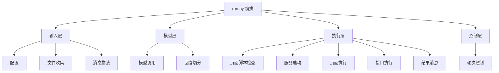
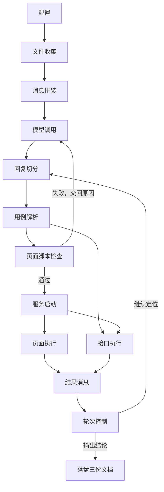

# 测试流水线说明

被测系统是已有的 React 前端和 Flask 后端。流水线只读源码、启动进程并请求接口，不修改 `frontend/` 与 `backend/`，也不补上用户名长度校验。预期以 PRD 为准。

## 1. 架构

程序分四层。`run.py` 只做编排。从属关系每行一条：

- `run.py` 调用输入层
- 输入层包含配置
- 输入层包含文件收集
- 输入层包含消息拼装
- `run.py` 调用模型层
- 模型层包含模型调用
- 模型层包含回复切分
- `run.py` 调用执行层
- 执行层包含页面脚本检查
- 执行层包含服务启动
- 执行层包含页面执行
- 执行层包含接口执行
- 执行层包含结果消息
- `run.py` 调用控制层
- 控制层包含轮次控制

外部对象三个：大模型 HTTP 接口、Vite 上的 React 页面、Flask 账号服务。页面脚本和截图落在 `pipeline/work/`。生成的 Markdown 文档落在当前目录下的 `AIgen-docs/`。

模块之间的数据流：

- 配置 -> 文件收集
- 文件收集 -> 消息拼装
- 消息拼装 -> 模型调用
- 模型调用 -> 回复切分
- 回复切分 -> 用例解析
- 用例解析 -> 页面脚本检查
- 页面脚本检查失败 -> 模型调用
- 页面脚本检查通过 -> 服务启动
- 用例解析 -> 接口执行
- 服务启动 -> 页面执行
- 服务启动 -> 接口执行
- 页面执行 -> 结果消息
- 接口执行 -> 结果消息
- 结果消息 -> 轮次控制
- 轮次控制选择继续定位 -> 回复切分
- 轮次控制选择输出结论 -> 落盘三份文档

`--dry-run` 在页面脚本检查通过并写完测试用例后结束，下一条边「页面脚本检查通过 -> 服务启动」不执行。

同一套结构的阅读图如下。

分层：



数据流：



`--dry-run` 停在「页面脚本检查通过」之后，不进入服务启动。

## 2. 运行序列

1. 配置模块校验参数。失败则打印缺少项并以非 0 退出。
2. 文件收集产出文件列表。消息拼装产出首轮用户消息。
3. 模型调用返回正文。回复切分写出 `AIgen-docs/测试用例.md` 和 `pipeline/work/ui/*.py`。
4. 用例解析得到页面用例和接口用例。页面脚本检查失败时，把原因交回模型，最多 `--codegen-retries` 次。
5. 服务启动确认前端 `http://localhost:5173` 与后端 `http://localhost:5000` 可访问。
6. 页面执行与接口执行各自返回结果。结果消息只打包本轮失败项。
7. 轮次控制读取模型回复的第一行。`决定：继续定位` 时回到步骤 3 的切分，且不再附带全部源码，轮数不超过 `--locate-rounds`。`决定：输出结论` 时写出执行记录、测试报告和 Bug 单。全部用例已通过时直接要求输出结论，不消耗定位轮数。

## 3. 模块

每个模块的输入来自上一模块或配置，输出交给下一模块。路径均相对仓库根目录。在仓库根目录执行时，当前目录就是仓库根目录。

### 3.1 配置

读取命令行和环境变量，得到一份运行配置。

|     | 内容                       |
| --- | ------------------------ |
| 输入  | 命令行参数；环境变量 `LLM_API_KEY` |
| 输出  | 配置对象。字段见下表。缺必选项时无输出，进程退出 |

| 字段                | 来源                                              | 约束                                                 |
| ----------------- | ----------------------------------------------- | -------------------------------------------------- |
| `sources`         | `--source`，可重复，无默认值                             | 必须同时包含前端目录和后端目录，例如 `frontend` 与 `backend`。目录不存在则退出 |
| `prd`             | `--prd`，默认 `docs/prd/登录注册Demo-PRD.md`           | 参数可省略，文件必须存在                                       |
| `api_key`         | `LLM_API_KEY`                                   | 只从环境变量读取。为空则退出。不写入仓库、命令行回显或日志                      |
| `docs`            | `--docs`，可重复，默认无                                | 追加到首轮消息。已有测试报告和已有 Bug 单被拒绝                         |
| `web_base`        | `--web-base`，默认 `http://localhost:5173`         | 页面脚本打开此地址                                          |
| `api_base`        | `--api-base`，默认 `http://localhost:5000`         | 接口用例请求此地址                                          |
| `requirements`    | `--req`，可重复，默认无                                 | 只保留列出的需求编号                                         |
| `channel`         | `--channel`，默认 `all`                            | `api`、`ui` 或 `all`                                 |
| `llm_base_url`    | `--llm-base-url`，默认 `https://api.openai.com/v1` | OpenAI 兼容地址                                        |
| `llm_model`       | `--llm-model`，默认 `gpt-4o-mini`                  | 模型名                                                |
| `max_tokens`      | `--max-tokens`，默认 `16384`                       | 单次回复的最大 token 数，不能超过模型输出上限                         |
| `codegen_retries` | `--codegen-retries`，默认 `3`                      | 页面脚本检查失败后的重新生成次数                                   |
| `locate_rounds`   | `--locate-rounds`，默认 `7`                        | 「决定：继续定位」的最多轮数                                     |
| `timeout`         | `--timeout`，默认 `120`                            | 单次 HTTP 或单条页面用例的超时秒数                               |
| `headed`          | `--headed`，默认关闭                                 | 打开后浏览器可见                                           |
| `work_dir`        | `--work-dir`，默认 `pipeline/work`                 | 脚本、截图、本轮结果、对话日志                                    |
| `dry_run`         | `--dry-run`，默认关闭                                | 为真时检查通过后停止                                         |

### 3.2 文件收集

按配置列出要送给模型的文件。

|     | 内容                          |
| --- | --------------------------- |
| 输入  | 配置中的 `sources`、`prd`、`docs` |
| 输出  | 文件列表。每项含相对仓库根目录的路径和文件原文     |

读取范围：`--source` 下的前端与后端源码，PRD，以及 `--docs` 指定的其他文档。前端需覆盖页面、路由和接口调用。后端需覆盖路由、请求体、响应文案和存储方式。

跳过 `node_modules/`、`dist/`、`package-lock.json`、`__pycache__/`、`*.db`、`.git/`、`pipeline/work/`。已有测试报告和已有 Bug 单即使出现在 `--docs` 中也跳过，并在日志中说明。

输出列表必须含 PRD、至少一份前端页面文件和 `backend/app.py`，且不含数据库文件和依赖目录。

### 3.3 消息拼装

把文件列表拼成一条用户消息。使用普通文本，不调用文件上传接口。

|     | 内容                                                          |
| --- | ----------------------------------------------------------- |
| 输入  | 文件列表；配置中的 `requirements`、`channel`；轮次类型（首轮或后续轮）；后续轮还要执行结果消息 |
| 输出  | 一条用户消息字符串                                                   |

首轮格式固定为四段：

1. `【目录】` 树，只含本次读入的路径。
2. 每个文件一块。路径单独一行，写在代码块外面，形如 `【文件 相对路径】`，后接带语言标记的 Markdown 代码块。
3. 文件原文含三个反引号时，该文件改用 `<file path="相对路径">` 与 `</file>`。
4. 任务说明放在最后一个文件之后。

首轮任务要求模型根据 PRD 写出需求规格说明书，格式对齐 `docs/srs/登录注册Demo-需求规格说明书.md`。这一步不写测试用例和页面脚本。说明书落盘并通过编号、字段检查后，下一条用户消息附上该说明书，要求据此生成测试用例和 Playwright 脚本。用例格式对齐 `docs/testcases/登录注册Demo-测试用例.md`。页面断言使用规格说明书和 PRD 中的预期原文。接口用例同时写入正文表格和文件末尾的 JSON。这两步都不输出测试执行记录、测试报告和 Bug 单。指定了 `requirements` 或 `channel` 时，用例任务写明范围；规格说明书仍覆盖 PRD。

执行结果之前的对话不再重复粘贴源码。执行之后的用户消息只包含模块 3.11 的执行结果。

### 3.4 模型调用

请求大模型并返回正文。

|     | 内容                                                          |
| --- | ----------------------------------------------------------- |
| 输入  | 配置中的 `llm_base_url`、`llm_model`、`api_key`、`max_tokens`；消息列表 |
| 输出  | 模型回复字符串。调用失败时不写测试文档，进程打印 HTTP 状态码后退出。已发出的用户消息仍留在对话日志        |

请求为 Chat Completions。请求体包含 `model`、`messages` 和 `max_tokens`。`max_tokens` 默认 16384。模型自身的输出上限无法取消，超过该上限时接口拒绝或仍以 `finish_reason=length` 截断。`messages` 中系统消息只放三条规则：预期以 PRD 为准；源码缺少长度校验时不得把预期改成注册成功；不修改产品代码。首轮用户消息来自模块 3.3。之后每轮把上一回复作为 `assistant`，新用户消息接在后面。密钥放在 `Authorization` 头。连通性探测、每次用户消息和模型回复写入工作目录下的 `dialogue.log`（默认 `pipeline/work/dialogue.log`），每次运行覆盖；日志不包含密钥、Authorization 头和带凭证的请求 URL。

### 3.5 回复切分

按分隔行把模型回复拆成文件并落盘。

|     | 内容                           |
| --- | ---------------------------- |
| 输入  | 模型回复字符串；当前阶段（首次生成、继续定位、输出结论） |
| 输出  | 已写入的路径列表。非法路径不写盘，并记为一次生成失败   |

分隔行格式：

```text
===== 相对路径 =====
文件正文
```

允许写入的路径：

| 阶段         | 路径                                                                    |
| ---------- | --------------------------------------------------------------------- |
| 规格说明书      | `AIgen-docs/需求规格说明书.md`                                               |
| 用例与脚本、继续定位 | `AIgen-docs/测试用例.md`，`pipeline/work/ui/*.py`                          |
| 输出结论       | `AIgen-docs/测试执行记录.md`，`AIgen-docs/测试报告.md`，`AIgen-docs/BUG-编号-标题.md` |

`AIgen-docs/` 相对当前目录。目录不存在则创建。拒绝写入 `frontend/`、`backend/`、仓库根目录之外的路径，以及下列手工文档：

- `docs/srs/登录注册Demo-需求规格说明书.md`
- `docs/prd/登录注册Demo-PRD.md`
- `docs/testcases/登录注册Demo-测试用例.md`
- `docs/test-records/登录注册Demo-测试执行记录.md`
- `docs/test-reports/登录注册Demo-测试报告.md`
- `docs/bugs/BUG-001-用户名长度不足仍可注册.md`

规格说明书阶段只接受需求规格说明书。用例阶段若回复含执行记录、测试报告或 Bug 单，丢弃这些段并要求模型只重发用例和页面脚本。

### 3.6 用例解析

从测试用例文档中取出可执行用例。

|     | 内容                                                                            |
| --- | ----------------------------------------------------------------------------- |
| 输入  | `AIgen-docs/测试用例.md`；配置中的 `requirements`、`channel`；`pipeline/work/ui/` 中的脚本路径 |
| 输出  | 页面用例列表和接口用例列表。解析失败时无列表，进入生成重试，不启动浏览器                                          |

正文中每条用例含编号、所属需求、通道（`ui` 或 `api`）、步骤、数据和预期原文。能拆出这些字段就可以执行，不在全文里搜固定句子或固定需求编号。

文件末尾有一个 json 代码块。接口用例字段为 `id`、`requirement`、`channel`、`method`、`path`、`body`、`expected_status`、`expected_text`。

输出前按 `requirements` 和 `channel` 过滤。每条页面用例的编号对应 `pipeline/work/ui/` 中的一个脚本。缺 json 代码块、字段缺失或页面用例没有脚本时，输出为空并进入重试。

### 3.7 页面脚本检查

在执行前检查已落盘的页面脚本。

|     | 内容                                       |
| --- | ---------------------------------------- |
| 输入  | `pipeline/work/ui/*.py`；对应用例的预期原文；剩余重试次数 |
| 输出  | 通过的脚本路径列表，或一条失败原因消息                      |

检查项：`compile` 通过；用例预期里用「」写出的提示要出现在脚本字符串中；脚本中不出现跳过测试。不另设固定提示词表，也不因某条预期写成注册成功而退回。

任一项失败时，输出的失败原因成为下一条用户消息，交回模块 3.4。次数不超过 `codegen_retries`。次数用尽后进程退出，不启动 Demo。

### 3.8 服务启动

保证被测系统可访问。端口已有进程监听则复用，并记录 pid，避免重复启动。流水线结束时不强制关闭本次启动的进程。

|     | 内容                          |
| --- | --------------------------- |
| 输入  | 配置中的 `web_base`、`api_base`  |
| 输出  | 前端基址、后端基址，以及本次新启动进程的 pid 列表 |

后端在仓库根目录执行 `python backend/app.py`。监听端口 `5000`，访问地址 `http://localhost:5000`。接口为 `GET /api/health`、`POST /api/register`、`POST /api/login`、`GET /api/me`、`POST /api/logout`。

前端是 Vite 启动的 React 应用，顺序为：

1. 本机已有 Node.js 和 npm。在 `frontend/` 执行 `npm install`，安装 React、React DOM、React Router、Ant Design、Axios 和 Vite。
2. 在仓库根目录执行 `npm run dev --prefix frontend`。该命令运行 `frontend/package.json` 中的 `vite`。
3. 终端出现 Local 地址后，开发服务器开始提供页面。

前端监听端口 `5173`，访问地址 `http://localhost:5173`。页面为 `/register`、`/login`、`/home`。打开 `/` 进入首页。前端请求账号服务的地址是 `http://localhost:5000`。`5173` 已监听则跳过启动。

完成条件：`GET http://localhost:5000/api/health` 成功，且 `http://localhost:5173/register` 能打开。

### 3.9 页面执行

用子进程运行页面脚本，并收集退出码。

|     | 内容                                           |
| --- | -------------------------------------------- |
| 输入  | 通过检查的脚本路径；配置中的 `headed`、`timeout`、`web_base` |
| 输出  | 每条用例一条结果：用例编号、退出码、标准输出、地址、截图路径               |

首次执行前安装：

```text
pip install playwright
python -m playwright install chromium
```

在仓库根目录运行脚本，同时捕获标准输出和退出码。`headed` 为真时浏览器可见，否则无头。单条超时为 `timeout` 秒。退出码 `0` 表示页面出现预期文案，`1` 表示没有。PowerShell 中退出码位于 `$LASTEXITCODE`。

运行约定与示例一致：

```text
python pipeline/example/register_short_username.py
```

示例的标准输出包含用例、预期、实际、地址和截图路径，截图为 `pipeline/example/last-result.png`。流水线脚本位于 `pipeline/work/ui/`。失败截图写入 `pipeline/work/screenshots/`，文件名含用例编号。

按当前预埋缺陷，不足 6 位用户名会注册成功。该示例的退出码应为 `1`，实际文案为「注册成功，请登录」。通过与否以退出码为准。

### 3.10 接口执行

按接口用例发送 HTTP 请求。不生成 Playwright。

|     | 内容                               |
| --- | -------------------------------- |
| 输入  | 接口用例列表；配置中的 `api_base`、`timeout` |
| 输出  | 每条用例一条结果：用例编号、实际状态码、响应正文、通过或失败   |

比较实际状态码与 `expected_status`，并检查响应正文是否包含 `expected_text`。比较由本模块完成。

### 3.11 结果消息

把本轮执行结果拼成下一条用户消息。

|     | 内容                                     |
| --- | -------------------------------------- |
| 输入  | 页面执行结果；接口执行结果；对应用例的预期原文                |
| 输出  | 一条用户消息。其中预期原文与用例一致，实际结果来自模块 3.9 或 3.10 |

通过的用例只保留编号和「通过」。失败项格式：

```text
【执行结果】
用例：TC-UI-REG-002
需求：REQ-REG-002
脚本：pipeline/work/ui/test_tc_ui_reg_002.py
结果：失败
预期：用户名长度不足
实际：页面出现「注册成功，请登录」，地址变为 /login
退出码：1
截图：pipeline/work/screenshots/TC-UI-REG-002.png
输出摘录：
...过长则截断...
```

接口失败使用同一格式。脚本行改为请求方法和 URL，退出码改为实际 HTTP 状态码。

消息末尾要求模型只做一件事：继续写 Playwright 以缩小失败位置，或给出最终文档。继续定位时断言仍用该条预期原文。回复第一行只能是 `决定：继续定位` 或 `决定：输出结论`。

### 3.12 轮次控制

根据模型回复决定回到执行层，还是结束。

|     | 内容                                               |
| --- | ------------------------------------------------ |
| 输入  | 模型回复第一行及余下正文；本轮是否全部通过；已用定位轮数；`locate_rounds`     |
| 输出  | 下一动作：`继续定位` 或 `输出结论`。继续定位时附带新的脚本正文；输出结论时附带三份文档正文 |

`决定：继续定位` 时，余下内容只能是新的 Playwright 文件，分隔行格式与模块 3.5 相同。随后交给回复切分、页面脚本检查和页面执行。轮数不超过 `locate_rounds`。用尽后，下一条用户消息声明只接受 `决定：输出结论`。

`决定：输出结论` 时，余下内容交给回复切分落盘。三份文档的内容要求：

- 测试执行记录按用例写下步骤、预期、实际和通过或失败。
- 测试报告包含环境、通过与失败统计、失败说明和结论。环境写明前端 `http://localhost:5173` 与账号服务 `http://localhost:5000`。
- 同一需求的页面失败和接口失败合并为一张 Bug 单。单内包含编号、标题、严重程度、所属需求、关联用例、复现步骤、预期结果、实际结果。实际结果出自执行结果消息。

第一行不是这两种决定时，计一次失败并要求模型重发。全部用例通过时输出动作为 `输出结论`，不消耗定位轮数。存在失败且在轮数内得出结论时，`AIgen-docs/` 下出现对应的 `BUG-编号-标题.md`。`REQ-REG-002` 在当前实现下应失败并进入 Bug 单。

## 4. 产物

| 产物      | 产生模块 | 路径                           |
| ------- | ---- | ---------------------------- |
| 需求规格说明书 | 回复切分 | `AIgen-docs/需求规格说明书.md`      |
| 测试用例    | 回复切分 | `AIgen-docs/测试用例.md`         |
| 测试执行记录  | 回复切分 | `AIgen-docs/测试执行记录.md`       |
| 测试报告    | 回复切分 | `AIgen-docs/测试报告.md`         |
| Bug 单   | 回复切分 | `AIgen-docs/BUG-编号-标题.md`    |
| 页面脚本    | 回复切分 | `pipeline/work/ui/*.py`      |
| 失败截图    | 页面执行 | `pipeline/work/screenshots/` |
| 对话日志    | 模型调用 | `pipeline/work/dialogue.log` |

`pipeline/work/` 不纳入版本库。`AIgen-docs/` 不覆盖 `docs/` 中的手工文档。
